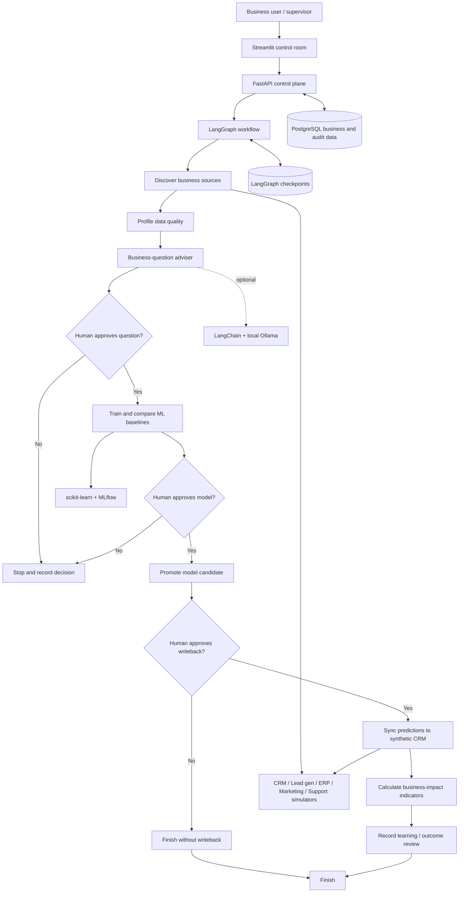

# Architecture and Technical Walkthrough

## 1. System overview

The project uses a deliberately simple hybrid architecture. Fixed operations such as reading approved tables, calculating metrics, recording approvals and syncing a batch are ordinary code. Language-model reasoning is optional and used only where flexible language understanding can help. The discovery stage profiles all five synthetic datasets for field types, missingness, duplicates, numeric summaries, frequent categories and pairwise numeric associations before the business question is reviewed.

## 2. Component responsibilities

| Component | Purpose | Why this project uses it |
|---|---|---|
| Streamlit | User-facing dashboard | Lets a non-technical supervisor start work and approve/reject stages |
| FastAPI | HTTP application interface | Exposes workflow, health and synthetic business endpoints with interactive API docs |
| PostgreSQL | Main relational database | Stores fictional business entities, workflow records, model versions, prediction scores and feedback |
| SQLAlchemy | Database access layer | Keeps database operations structured and makes SQLite testing possible |
| LangGraph | Workflow orchestration | Models explicit states, conditional routes, pauses and resumes |
| LangGraph SQLite checkpointer | Workflow state persistence | Stores approval-waiting graph state for the local demo |
| LangChain | LLM integration abstraction | Provides a consistent way to call an optional local model |
| Ollama | Local model runner | Avoids a mandatory paid API for optional language-based advice |
| pandas / NumPy | Data handling and synthetic generation | Reads and profiles tabular data, creates repeatable sample records |
| scikit-learn | Classical machine-learning toolkit | Builds reproducible baseline models with preprocessing pipelines |
| MLflow | Experiment tracking | Captures selected models, parameters, metrics and artifacts |

## 3. Why LangGraph and LangChain are both present

They solve related but different problems.

- **LangChain is the model-and-tool integration layer.** It makes it easier to connect a language model to tools and structured prompts. In this project, the optional adviser calls Ollama through `ChatOllama`.
- **LangGraph is the workflow engine.** It specifies which stage runs next, what state is retained, where branches occur and where the workflow pauses until a person responds.

A language model should not be trusted to remember whether an approval was given. That is a workflow state and permission check, so it belongs in ordinary application logic and LangGraph control flow.

The official LangGraph documentation describes it as a low-level orchestration framework for long-running, stateful workflows and highlights persistence, durable execution and human-in-the-loop operation. See [LangGraph overview](https://docs.langchain.com/oss/python/langgraph/overview) and [interrupts](https://docs.langchain.com/oss/python/langgraph/interrupts).

## 4. Specialist-agent design, inspired by MLZero

The project now separates several responsibilities into focused Python agents. This borrows the useful role decomposition used by AutoGluon Assistant / MLZero (data perception, task description, tool selection, coding/execution and error/review roles) without copying its research implementation or allowing unrestricted generated-code execution.

| Specialist | Python entry point | Responsibility | Execution boundary |
|---|---|---|---|
| Data perception | `agents.run_data_perception` | Summarize schema, missingness, duplicates, distributions and association warnings | Read-only summaries |
| Task descriptor | `agents.run_task_planner` | Convert the selected business objective and supervisor instruction into a bounded plan | Produces a plan; does not execute code |
| Tool selector | `agents.run_tool_selector` | Choose from registered tools based on objective | Can only select tools in `tool_registry.py` |
| Business question adviser | `advisor.build_business_questions` | Propose measurable business questions and context | Optional LangChain/Ollama advice; human approves |
| ML execution | `_train` / `modeling.train_and_score` | Run fixed, tested model pipelines | No arbitrary code generation or shell execution |
| Model reviewer | `agents.run_reviewer` | Check holdout rows, training/scoring separation, artifact reference and quality gate | Provides review evidence; human still approves model promotion |
| Business integration | `sync_predictions` | Mark approved scores synchronized | Tool registry requires explicit approval |
| Business feedback | `api.record_outcome` | Capture verified outcomes for future model training | Accepts only an eligible previously synchronized prediction |

The registry is intentionally a capability boundary, not just a list of prompts. Each tool has a name, description, risk label, declared input fields and an approval requirement. Unknown tools are rejected; invalid arguments are rejected; write tools raise `PermissionError` unless the caller passes an explicit approval flag. The workflow uses separate LangGraph interrupts for consequential approvals.

This differs from a code-generating agent framework: MLZero's research implementation can generate and execute Python/Bash during iterative ML development, and its README recommends Docker isolation for that reason. This project uses constrained Python tool functions and predeclared scikit-learn pipelines. It trades open-ended task coverage for predictable, auditable behavior in a business system.

## 5. LangGraph lifecycle in this code

`src/agentic_ml_department/workflow.py` defines the state fields and graph nodes. The graph executes this sequence:

1. `discover_sources` — list the synthetic business-system connectors and counts.
2. `profile_data` — data-perception agent summarizes fields, distributions, missingness, duplicates and associations.
3. `plan_ml_tasks` — task-descriptor agent creates a bounded execution plan.
4. `select_allowed_tools` — tool-selector agent lists only explicitly registered capabilities.
5. `propose_business_questions` — produce the business question and analysis questions.
6. `approve_business_question` — pause using `interrupt()` and return an approval request.
7. `train_candidate_models` — train candidate classifiers, evaluate them and queue predictions internally.
8. `approve_model_promotion` — independent reviewer checks evidence, then the graph pauses for human model approval.
9. `promote_model` — mark the approved candidate model active.
10. `approve_business_writeback` — display a final writeback preview and pause.
11. `sync_predictions` — mark scores as synchronized only after approval.
12. `measure_business_impact` — calculate business prioritization estimates.
13. `record_learning` — store the review note for future comparison.
14. `finish` — create a final workflow summary.

When a node calls `interrupt(value)`, LangGraph persists the graph checkpoint and pauses execution. The API later resumes the same thread with `Command(resume=decision)`. The approval decision is data supplied by the user, not an instruction generated by the model.

The SQLite saver is suitable for this local, single-process demonstration. Its own reference describes it as a lightweight saver for demos and small projects, not as a multi-process production store. A production deployment should use a properly configured PostgreSQL checkpointer or another durable supported store, with backup and access controls. See [LangGraph checkpointing](https://docs.langchain.com/oss/python/langgraph/persistence) and [checkpointer reference](https://reference.langchain.com/python/langgraph/checkpoints).

## 5. Business-system connector contract

`src/agentic_ml_department/connectors.py` defines a small connector pattern. Each adapter provides a bounded view of one source system and a record count. The demonstration reads its local synthetic SQL tables.

In a real company, the same connector responsibilities should be implemented with its approved API, warehouse, event stream or database view. Use separate service identities and credentials; do not add unrestricted SQL or generic shell tools to an agent.

## 6. Model development lifecycle

`src/agentic_ml_department/modeling.py` implements:

- A declared feature list per business objective.
- A pre-training exploratory profile of all connected source datasets, including numeric distribution summaries and non-causal pairwise association summaries.
- Missing-value imputation and categorical one-hot encoding.
- Numeric scaling.
- Logistic regression and random forest candidates.
- A stratified holdout split.
- ROC AUC, PR AUC, precision, recall, F1 and sample counts.
- A deterministic threshold override for explicit recall/precision instructions.
- Joblib artifact storage.
- Prediction records with `PENDING_APPROVAL` status.
- Optional MLflow logging.

The selected pipeline is refit on all labelled historical rows only after the holdout evaluation has selected a candidate. Predictions are generated for the current synthetic records. These are internal queued records. They are not delivered to the business-system simulator until the writeback gate is approved.

The two objectives use different explicit feature sets. The project does not automatically join every field across every system because that can create leakage, incorrect entity matches or privacy issues.

## 7. MLflow tracking

MLflow is used to keep a record of experiments. Each logged experiment captures objective, selected model type, run identifier, key evaluation metrics and the model file as an artifact. The app also maintains its own small model-registry table so approval status is visible in the dashboard/API.

The MLflow registry documentation explains model lineage, versioning, aliases and lifecycle management. This prototype records the experiment and maintains a minimal application registry; a production release process should use the fuller registry lifecycle. See [MLflow Tracking](https://mlflow.org/docs/latest/ml/tracking/) and [Model Registry](https://mlflow.org/docs/latest/ml/model-registry/).

## 8. State and data persistence

| Information | Stored where | Survives API restart? |
|---|---|---|
| Synthetic business tables | PostgreSQL | Yes, with the Compose database volume |
| Workflow run and approval summary | PostgreSQL | Yes |
| LangGraph thread checkpoints | `data/checkpoints.sqlite` | Yes, if the mounted file is retained |
| Candidate model files | `artifacts/models/` | Yes, if the mounted folder is retained |
| MLflow runs and artifacts | MLflow database and `artifacts/mlflow/` | Yes, if database volume and folder are retained |
| Human outcome feedback | PostgreSQL | Yes |

The LangGraph checkpoint store is separate from the main business database in the local demo for ease of setup. For a production deployment, use a deliberately designed persistence architecture and ensure the graph thread, workflow record and approval audit are consistent.

## 9. Suggested production topology

A larger deployment should separate:

- User interface and identity provider.
- Workflow API and worker processes.
- Durable LangGraph checkpoint database.
- Business data warehouse or read replicas.
- Approved integration service for external writes.
- MLflow tracking and model registry.
- Object storage for model and analysis artifacts.
- Central logs, metrics, traces and security audit events.
- Secrets manager and policy enforcement service.

Keep the integration service between agents and business systems. It can validate caller identity, enforce scope, reject disallowed actions, apply idempotency keys and log every write.

## 10. Current proof-of-concept boundary

The code is designed to demonstrate the full controlled path on synthetic data. It is not yet a multi-tenant product, a production model-serving platform, a complete feature store, a full model-monitoring system or a universal natural-language-to-business-policy compiler. Its tests and documentation are intentionally explicit about this boundary.
